<!--
 * @Author: Shadows_Lunarfox 91894334+ShadowsLunarfox@users.noreply.github.com
 * @Date: 2026-07-30 16:33:16
 * @LastEditors: Shadows_Lunarfox 91894334+ShadowsLunarfox@users.noreply.github.com
 * @LastEditTime: 2026-10-15 02:20:32
 * @FilePath: \ShadowsLunarfox\README.md
 * @Description: 这是默认设置,请设置`customMade`, 打开koroFileHeader查看配置 进行设置: https://github.com/OBKoro1/koro1FileHeader/wiki/%E9%85%8D%E7%BD%AE
-->

<!-- BEGIN typing-animation -->

  <picture>
    <source media="(prefers-color-scheme: dark)" srcset="https://readme-typing-svg.demolab.com?font=Fira+Code&amp;size=22&amp;pause=1200&amp;color=FFAEC5&amp;background=00000000&amp;center=true&amp;vCenter=true&amp;width=760&amp;height=60&amp;lines=Hi%2C+I%27m+Shadows_Lunarfox+%E6%9C%88%E7%8B%90;Building+websites%2C+games+%26+little+experiments;Coding+from+Kuala+Lumpur%2C+Malaysia" />
    
  </picture>

<!-- END typing-animation -->

  
  
  

<!-- BEGIN lunarfox-corner -->
<h2 align="center">🌙 <samp>Lunarfox's Cozy Corner · 月狐小窝</samp> 🐾</h2>

<table align="center" width="100%">
  <tr>
    <td align="center" valign="middle" width="28%">
      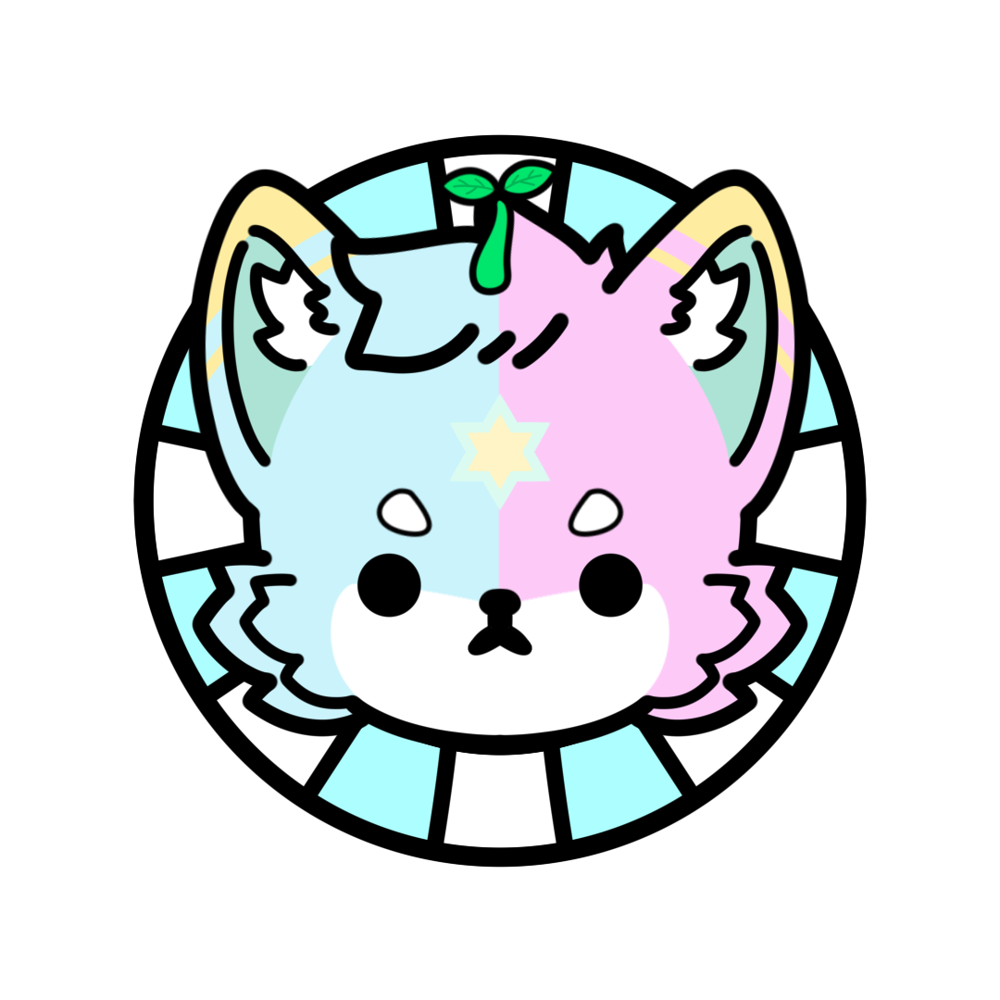
       
      <strong><samp>月狐 · Lunarfox</samp></strong>
       
      <em>🌙 Small ideas, fluffy tails ✨</em> <samp>(ᵔᴥᵔ)</samp>
    </td>
    <td valign="top" width="72%">
      
👋 Hi, I'm <strong><samp>Shadows_Lunarfox 月狐</samp></strong> 🦊 <samp>(｡･ω･｡)ﾉ</samp> 
      📍 A developer from <strong>Kuala Lumpur, Malaysia</strong>. I like building websites, games, small tools, and experiments that feel polished enough to keep.

      
<strong>🍡 Coding Languages</strong> 
        
        
        
        
        
        
        
      

      
<strong>🎨 Creative Toolbox</strong> 
        
        
        
        
        
        
      

      
<strong>💌 Come Say Hello</strong> 
        
        
        
        
        
      

    </td>
  </tr>
</table>
<!-- END lunarfox-corner -->

<!-- BEGIN featured-repositories -->
<!-- Generated from .github/featured-repositories.json; edit that file to change the cards. -->
<h2>✨ <samp>Featured Repositories (ง •̀_•́)ง</samp></h2>

  <a href="https://github.com/ShadowsLunarfox/Roblox-Customizer">
    <picture>
      <source media="(prefers-color-scheme: dark)" srcset="assets/profile/repositories/repo-1-dark.svg" />
      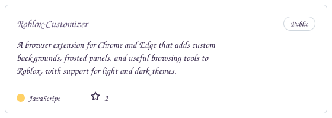
    </picture>
  </a>
  <a href="https://github.com/ShadowsLunarfox/YouTube-Customizer">
    <picture>
      <source media="(prefers-color-scheme: dark)" srcset="assets/profile/repositories/repo-2-dark.svg" />
      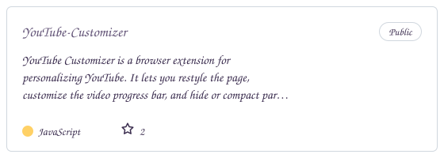
    </picture>
  </a>

  <a href="https://github.com/ShadowsLunarfox/Selection-Text-Reader">
    <picture>
      <source media="(prefers-color-scheme: dark)" srcset="assets/profile/repositories/repo-3-dark.svg" />
      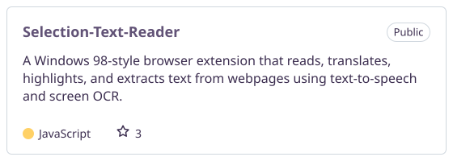
    </picture>
  </a>
  <a href="https://github.com/ShadowsLunarfox/Custom-Browser-Homepage">
    <picture>
      <source media="(prefers-color-scheme: dark)" srcset="assets/profile/repositories/repo-4-dark.svg" />
      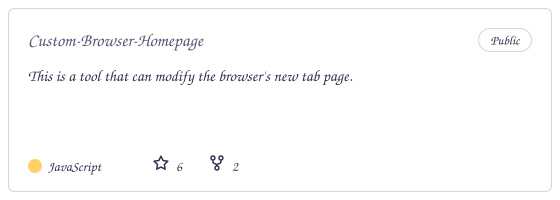
    </picture>
  </a>

  <a href="https://github.com/ShadowsLunarfox/Server-Check-Status">
    <picture>
      <source media="(prefers-color-scheme: dark)" srcset="assets/profile/repositories/repo-5-dark.svg" />
      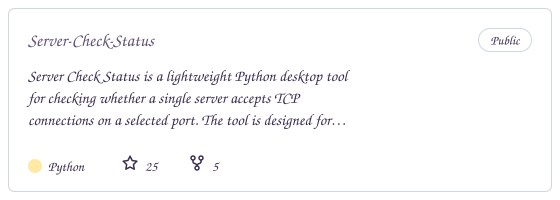
    </picture>
  </a>
  <a href="https://github.com/ShadowsLunarfox/Custom-Hierarchy-for-Unity">
    <picture>
      <source media="(prefers-color-scheme: dark)" srcset="assets/profile/repositories/repo-6-dark.svg" />
      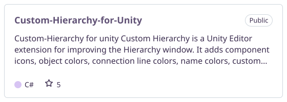
    </picture>
  </a>

  <a href="https://github.com/ShadowsLunarfox/Custom-Folder-For-Unity">
    <picture>
      <source media="(prefers-color-scheme: dark)" srcset="assets/profile/repositories/repo-7-dark.svg" />
      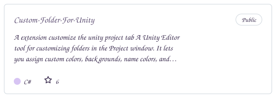
    </picture>
  </a>

<!-- END featured-repositories -->

<h2 align="center">📊 <samp>GitHub Stats (＾▽＾)</samp></h2>

  <picture>
    <source media="(prefers-color-scheme: dark)" srcset="https://github-readme-stats.shion.dev/api?username=ShadowsLunarfox&amp;theme=transparent&amp;bg_color=00000000&amp;hide_border=true&amp;title_color=ffaec5&amp;text_color=adbac7&amp;icon_color=d7c4f3&amp;ring_color=b9edf2&amp;show_icons=true&amp;include_all_commits=false&amp;count_private=false&amp;card_width=495" />
    
  </picture>
  <picture>
    <source media="(prefers-color-scheme: dark)" srcset="https://streak-stats.demolab.com/?user=ShadowsLunarfox&amp;theme=transparent&amp;background=00000000&amp;hide_border=true&amp;stroke=615276&amp;ring=d7c4f3&amp;fire=ffd3b0&amp;currStreakNum=adbac7&amp;sideNums=adbac7&amp;currStreakLabel=ffaec5&amp;sideLabels=d7c4f3&amp;dates=adbac7&amp;card_width=495" />
    
  </picture>
  <picture>
    <source media="(prefers-color-scheme: dark)" srcset="assets/profile/languages-dark.svg" />
    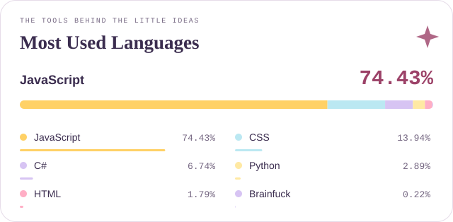
  </picture>

<!-- BEGIN activity-graph -->
<h2 align="center">🌱 <samp>Activity Graph</samp></h2>

  <picture>
    <source media="(prefers-color-scheme: dark)" srcset="assets/profile/activity.svg" />
    
  </picture>

<!-- END activity-graph -->

<h2 align="center">🐍 <samp>Contribution Snake</samp></h2>

  <picture>
    <source media="(prefers-color-scheme: dark)" srcset="assets/profile/github-snake-dark.svg" />
    <source media="(prefers-color-scheme: light)" srcset="assets/profile/github-snake.svg" />
    
  </picture>

<!-- BEGIN 3d-contributions -->
<h2 align="center">🌌 <samp>3D Contributions (☆▽☆)</samp></h2>

  <picture>
    <source media="(prefers-color-scheme: dark)" srcset="assets/profile/3d-contributions-dark.svg" />
    <source media="(prefers-color-scheme: light)" srcset="assets/profile/3d-contributions-light.svg" />
    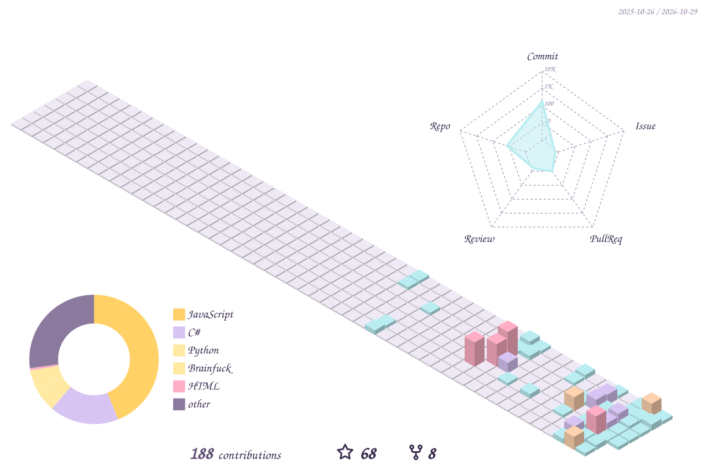
  </picture>

<!-- END 3d-contributions -->

