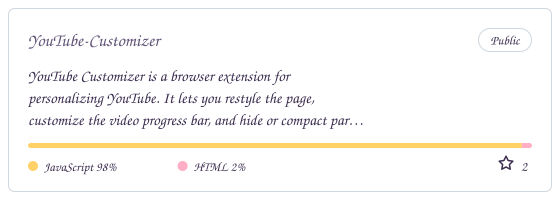
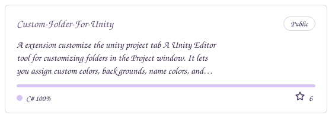
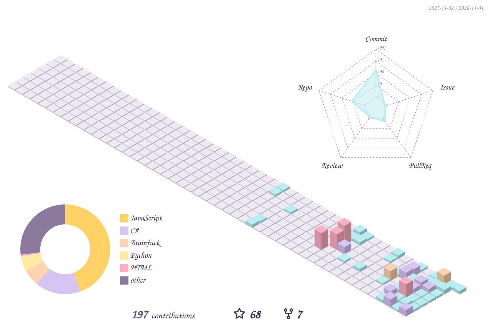

<picture data-profile-source="assets/profile/header.svg">
  <source media="(prefers-color-scheme: dark)" srcset="assets/profile/themed-images/header-dark.svg?v=cfc65f3a7687" />
  
</picture>

<!-- BEGIN typing-animation -->

  <picture>
    <source media="(prefers-color-scheme: dark)" srcset="https://readme-typing-svg.demolab.com?font=Comic+Neue&amp;size=22&amp;pause=1200&amp;color=FFAEC5&amp;background=00000000&amp;center=true&amp;vCenter=true&amp;width=760&amp;height=60&amp;lines=Hi%2C+I%27m+Shadows_Lunarfox;Building+websites%2C+games+%26+little+experiments;Coding+from+Kuala+Lumpur%2C+Malaysia" />
    
  </picture>

<!-- END typing-animation -->

  <picture data-profile-source="https://komarev.com/ghpvc/?username=ShadowsLunarfox&amp;label=Profile%20Views&amp;color=ffaec5&amp;style=for-the-badge">
  <source media="(prefers-color-scheme: dark)" srcset="https://komarev.com/ghpvc/?username=ShadowsLunarfox&amp;label=Profile+Views&amp;color=482e40&amp;style=for-the-badge" />
  
</picture>
  <picture data-profile-source="https://img.shields.io/github/stars/ShadowsLunarfox?affiliations=OWNER%2CCOLLABORATOR&amp;style=for-the-badge&amp;color=b9edf2&amp;labelColor=615276">
  <source media="(prefers-color-scheme: dark)" srcset="https://img.shields.io/github/stars/ShadowsLunarfox?affiliations=OWNER%2CCOLLABORATOR&amp;style=for-the-badge&amp;color=25434c&amp;labelColor=302a3d" />
  
</picture>
  <a href="https://github.com/ShadowsLunarfox?tab=repositories&amp;type=public"><picture data-profile-source="assets/profile/public-repositories.svg?v=2">
  <source media="(prefers-color-scheme: dark)" srcset="assets/profile/themed-images/public-repositories-dark.svg?v=32461cef9ef8" />
  
</picture></a>

<!-- BEGIN professional-intro -->
<h2 align="center"><samp>About Me</samp></h2>

  <strong>Hi, I'm Shadows_Lunarfox.</strong> 
  Software, web &amp; game developer · Kuala Lumpur, Malaysia

🍼🦊 <em>I'm a Malaysian furry with a kemono fox fursona.</em> 
  📷 I'm also a photographer and fursuiter.

  <strong>🧸 Baby Traits</strong> 
  Must hug a plushie to sleep. Always fidgeting with small movements—never staying still. Occasionally sneaks out a pacifier or other silly accessories. 🤫

 

<blockquote>
  
<strong>Practical tools. Worlds to explore.</strong> 
  I build websites, practical software, and virtual worlds for play and exploration.

</blockquote>

<ul>
  <li>💻 <strong>Web development</strong> — Websites and web interfaces with a focus on usability.</li>
  <li>🌐 <strong>Game &amp; world development</strong> — Gameplay maps and scenic worlds for VRChat and Roblox.</li>
  <li>🧩 <strong>Browser extensions</strong> — Interface customization, text-to-speech, and translation.</li>
  <li>🛠️ <strong>Windows utilities</strong> — Desktop helpers and server connectivity checks.</li>
  <li>🎮 <strong>Unity Editor tools</strong> — Editor enhancements for smoother development.</li>
</ul>

<h3>💾 <samp>Retro Collector</samp></h3>

  Besides coding, I have a weird hobby—collecting <strong>vintage and classic tech gear</strong>.

  Vintage components and retro devices feel like works of art to me! Bringing them back to life gives me more adrenaline than running new code. I guess I'm a <strong>“digital archaeologist”</strong>, digging for treasure in electronic ruins.

<!-- END professional-intro -->

<!-- BEGIN profile-overview -->
<table width="100%" align="center" role="presentation">
<tbody>
<tr>
<td width="48%" valign="top">
<!-- BEGIN programming-languages -->
<h2 align="center">⌨️ <samp>Programming Languages</samp></h2>

  <picture data-profile-source="https://img.shields.io/badge/Python-ffe9a3?style=flat-square&amp;logo=python&amp;logoColor=3b2d4f">
  <source media="(prefers-color-scheme: dark)" srcset="https://img.shields.io/badge/Python-493f2a?style=flat-square&amp;logo=python&amp;logoColor=ffe9a3" />
  
</picture>
  <picture data-profile-source="https://img.shields.io/badge/JavaScript-ffd166?style=flat-square&amp;logo=javascript&amp;logoColor=3b2d4f">
  <source media="(prefers-color-scheme: dark)" srcset="https://img.shields.io/badge/JavaScript-493c23?style=flat-square&amp;logo=javascript&amp;logoColor=ffd166" />
  
</picture>
  <picture data-profile-source="https://img.shields.io/badge/C%23-d7c4f3?style=flat-square">
  <source media="(prefers-color-scheme: dark)" srcset="https://img.shields.io/badge/C%23-393149?style=flat-square" />
  
</picture>
   
  <picture data-profile-source="https://img.shields.io/badge/HTML-ffaec5?style=flat-square&amp;logo=html5&amp;logoColor=3b2d4f">
  <source media="(prefers-color-scheme: dark)" srcset="https://img.shields.io/badge/HTML-482e40?style=flat-square&amp;logo=html5&amp;logoColor=ffaec5" />
  
</picture>
  <picture data-profile-source="https://img.shields.io/badge/CSS-bbe8f2?style=flat-square&amp;logo=css&amp;logoColor=3b2d4f">
  <source media="(prefers-color-scheme: dark)" srcset="https://img.shields.io/badge/CSS-25434c?style=flat-square&amp;logo=css&amp;logoColor=bbe8f2" />
  
</picture>

<!-- END programming-languages -->
</td>
<td width="52%" valign="top">
<!-- BEGIN apps-i-use -->
<h2 align="center">🛠️ <samp>Apps I Use</samp></h2>

  <picture data-profile-source="https://img.shields.io/badge/VS_Code-bce6f4?style=flat-square">
  <source media="(prefers-color-scheme: dark)" srcset="https://img.shields.io/badge/VS_Code-263e51?style=flat-square" />
  
</picture>
  <picture data-profile-source="https://img.shields.io/badge/Unity-d3bcf5?style=flat-square&amp;logo=unity&amp;logoColor=3b2d4f">
  <source media="(prefers-color-scheme: dark)" srcset="https://img.shields.io/badge/Unity-393149?style=flat-square&amp;logo=unity&amp;logoColor=d3bcf5" />
  
</picture>
   
  <picture data-profile-source="https://img.shields.io/badge/Blender-ffc6a6?style=flat-square&amp;logo=blender&amp;logoColor=3b2d4f">
  <source media="(prefers-color-scheme: dark)" srcset="https://img.shields.io/badge/Blender-49362f?style=flat-square&amp;logo=blender&amp;logoColor=ffc6a6" />
  
</picture>
  <picture data-profile-source="https://img.shields.io/badge/CapCut-ffaec5?style=flat-square">
  <source media="(prefers-color-scheme: dark)" srcset="https://img.shields.io/badge/CapCut-482e40?style=flat-square" />
  
</picture>
  <picture data-profile-source="https://img.shields.io/badge/OBS-d7c4f3?style=flat-square&amp;logo=obsstudio&amp;logoColor=3b2d4f">
  <source media="(prefers-color-scheme: dark)" srcset="https://img.shields.io/badge/OBS-393149?style=flat-square&amp;logo=obsstudio&amp;logoColor=d7c4f3" />
  
</picture>
   
  <picture data-profile-source="https://img.shields.io/badge/Lightroom-bce6f4?style=flat-square">
  <source media="(prefers-color-scheme: dark)" srcset="https://img.shields.io/badge/Lightroom-263e51?style=flat-square" />
  
</picture>
  <picture data-profile-source="https://img.shields.io/badge/Photoshop-bbe8f2?style=flat-square">
  <source media="(prefers-color-scheme: dark)" srcset="https://img.shields.io/badge/Photoshop-25434c?style=flat-square" />
  
</picture>

<!-- END apps-i-use -->
</td>
</tr>
<tr>
<td colspan="2" align="center">
<!-- BEGIN contact-links -->
<h3 align="center">💌 <samp>Come Say Hello</samp></h3>

  <a href="https://discord.com" title="Discord: shadows_lunarfox"><picture data-profile-source="https://img.shields.io/badge/Discord-d7c4f3?style=flat-square&amp;logo=discord&amp;logoColor=3b2d4f">
  <source media="(prefers-color-scheme: dark)" srcset="https://img.shields.io/badge/Discord-393149?style=flat-square&amp;logo=discord&amp;logoColor=d7c4f3" />
  
</picture></a>
  <a href="https://lunarfox.my" title="Website: lunarfox.my"><picture data-profile-source="https://img.shields.io/badge/lunarfox.my-ffaec5?style=flat-square&amp;logo=firefox&amp;logoColor=3b2d4f">
  <source media="(prefers-color-scheme: dark)" srcset="https://img.shields.io/badge/lunarfox.my-482e40?style=flat-square&amp;logo=firefox&amp;logoColor=ffaec5" />
  
</picture></a>
  <a href="https://www.tiktok.com/@shadows_lunarfox" title="TikTok: @shadows_lunarfox"><picture data-profile-source="https://img.shields.io/badge/TikTok-b9edf2?style=flat-square&amp;logo=tiktok&amp;logoColor=3b2d4f">
  <source media="(prefers-color-scheme: dark)" srcset="https://img.shields.io/badge/TikTok-25434c?style=flat-square&amp;logo=tiktok&amp;logoColor=b9edf2" />
  
</picture></a>
  <a href="https://x.com/ShadowsLunarfox" title="X: @ShadowsLunarfox"><picture data-profile-source="https://img.shields.io/badge/X-ffdab9?style=flat-square&amp;logoColor=3b2d4f">
  <source media="(prefers-color-scheme: dark)" srcset="https://img.shields.io/badge/X-49392f?style=flat-square&amp;logoColor=ffdab9" />
  
</picture></a>
  <a href="https://t.me/Shadows_Lunarfox" title="Telegram: @Shadows_Lunarfox"><picture data-profile-source="https://img.shields.io/badge/Telegram-b9edf2?style=flat-square&amp;logo=telegram&amp;logoColor=3b2d4f">
  <source media="(prefers-color-scheme: dark)" srcset="https://img.shields.io/badge/Telegram-25434c?style=flat-square&amp;logo=telegram&amp;logoColor=b9edf2" />
  
</picture></a>
  <a href="https://www.facebook.com/Lunarfoxyuehu/" title="Facebook: Lunarfoxyuehu"><picture data-profile-source="https://img.shields.io/badge/Facebook-bbe8f2?style=flat-square&amp;logo=facebook&amp;logoColor=3b2d4f">
  <source media="(prefers-color-scheme: dark)" srcset="https://img.shields.io/badge/Facebook-25434c?style=flat-square&amp;logo=facebook&amp;logoColor=bbe8f2" />
  
</picture></a>
  <a href="https://space.bilibili.com/3493269644249683" title="Bilibili: UID 3493269644249683"><picture data-profile-source="https://img.shields.io/badge/Bilibili-ffaec5?style=flat-square&amp;logo=bilibili&amp;logoColor=3b2d4f">
  <source media="(prefers-color-scheme: dark)" srcset="https://img.shields.io/badge/Bilibili-482e40?style=flat-square&amp;logo=bilibili&amp;logoColor=ffaec5" />
  
</picture></a>
  <a href="https://www.reddit.com/user/shadowlunarfox/" title="Reddit: u/shadowlunarfox"><picture data-profile-source="https://img.shields.io/badge/Reddit-ffc6a6?style=flat-square&amp;logo=reddit&amp;logoColor=3b2d4f">
  <source media="(prefers-color-scheme: dark)" srcset="https://img.shields.io/badge/Reddit-49362f?style=flat-square&amp;logo=reddit&amp;logoColor=ffc6a6" />
  
</picture></a>

<!-- END contact-links -->
</td>
</tr>
</tbody>
</table>
<!-- END profile-overview -->

<!-- BEGIN daily-dev-note -->
<blockquote>
<h3 align="center">💬 <samp>Daily Dev Note</samp></h3>
<h3 align="center"><em>One clear error message beats ten mysterious crashes.</em></h3>

2026-11-14 · Kuala Lumpur

</blockquote>
<!-- END daily-dev-note -->

<!-- BEGIN easter-egg -->

🎁 Nothing hidden here

  <picture data-profile-source="assets/profile/hidden-fox.png">
  <source media="(prefers-color-scheme: dark)" srcset="assets/profile/themed-images/image-15e237b21500-dark.svg?v=a6fd5620bd4c" />
  
</picture> 
  <strong>Achievement unlocked: you found a fox taking a break.</strong> 
  <em>Code worked on the first try? Make sure you didn't run yesterday's build.</em>

<!-- END easter-egg -->

<!-- BEGIN learning-badges -->
<h2 align="center">🏅 <samp>Learning &amp; Badges</samp></h2>

  <a href="https://g.dev/lunarfox"><strong>Google Developer Program</strong></a> · 4 badges
   
  <a href="https://developers.google.com/profile/badges/profile/created-profile?u=lunarfox"><picture data-profile-source="https://developers.google.com/static/profile/badges/profile/created-profile/created_profile.svg">
  <source media="(prefers-color-scheme: dark)" srcset="assets/profile/themed-images/image-c9d5519be70c-dark.svg?v=0e0399d92434" />
  
</picture></a>
  <a href="https://developers.google.com/profile/badges/community/gdg/discovery?u=lunarfox"><picture data-profile-source="https://developers.google.com/static/profile/badges/community/gdg/discovery/badge.svg">
  <source media="(prefers-color-scheme: dark)" srcset="assets/profile/themed-images/image-560ed8eb7fb0-dark.svg?v=c543b6db125e" />
  
</picture></a>
  <a href="https://developers.google.com/profile/badges/community/sdlcagents/gca-agents?u=lunarfox"><picture data-profile-source="https://developers.google.com/static/profile/badges/community/sdlcagents/gca-agents/badge.svg">
  <source media="(prefers-color-scheme: dark)" srcset="assets/profile/themed-images/image-7be106bfac78-dark.svg?v=497a7b2ed7eb" />
  
</picture></a>
  <a href="https://developers.google.com/profile/badges/nvidia-developer?u=lunarfox"><picture data-profile-source="https://developers.google.com/static/profile/badges/nvidia-developer/badge.svg">
  <source media="(prefers-color-scheme: dark)" srcset="assets/profile/themed-images/image-88262142d7b9-dark.svg?v=64c66a96e345" />
  
</picture></a>

  <a href="https://learn.microsoft.com/en-us/users/shadowslunarfox-4093/achievements"><strong>Microsoft Learn</strong></a> · 4 module badges · 2 trophies
   
  <a href="https://learn.microsoft.com/en-us/users/shadowslunarfox-4093/achievements"><picture data-profile-source="https://learn.microsoft.com/training/achievements/generic.svg">
  <source media="(prefers-color-scheme: dark)" srcset="assets/profile/themed-images/image-af62d01c3d88-dark.svg?v=dc3efe910bc9" />
  
</picture></a>
  <a href="https://learn.microsoft.com/en-us/users/shadowslunarfox-4093/achievements"><picture data-profile-source="https://learn.microsoft.com/training/achievements/generic-badge.svg">
  <source media="(prefers-color-scheme: dark)" srcset="assets/profile/themed-images/image-f8f57098cb88-dark.svg?v=97cddce0b849" />
  
</picture></a>
  <a href="https://learn.microsoft.com/en-us/users/shadowslunarfox-4093/achievements"><picture data-profile-source="https://learn.microsoft.com/learn/achievements/generic-badge.svg">
  <source media="(prefers-color-scheme: dark)" srcset="assets/profile/themed-images/image-d88c472664c6-dark.svg?v=751331a1a99a" />
  
</picture></a>
  <a href="https://learn.microsoft.com/en-us/users/shadowslunarfox-4093/achievements"><picture data-profile-source="https://learn.microsoft.com/training/achievements/generic-trophy.svg">
  <source media="(prefers-color-scheme: dark)" srcset="assets/profile/themed-images/image-1c2f65ceed92-dark.svg?v=95ea16f3cf0b" />
  
</picture></a>
  <a href="https://learn.microsoft.com/en-us/users/shadowslunarfox-4093/achievements"><picture data-profile-source="https://learn.microsoft.com/training/achievements/generic-trophy.svg">
  <source media="(prefers-color-scheme: dark)" srcset="assets/profile/themed-images/image-981205f74d97-dark.svg?v=36528eeda899" />
  
</picture></a>
  <a href="https://learn.microsoft.com/en-us/users/shadowslunarfox-4093/achievements"><picture data-profile-source="https://learn.microsoft.com/training/achievements/generic-badge.svg">
  <source media="(prefers-color-scheme: dark)" srcset="assets/profile/themed-images/image-c931f2eb8772-dark.svg?v=6626f08124b4" />
  
</picture></a>

Badge details · 10 achievements

<table>
  <tr><th>Platform</th><th>Achievement</th><th>Details</th></tr>
  <tr><td>Google</td><td><a href="https://developers.google.com/profile/badges/profile/created-profile?u=lunarfox">Joined the Google Developer Program</a></td><td>Program badge</td></tr>
  <tr><td>Google</td><td><a href="https://developers.google.com/profile/badges/community/gdg/discovery?u=lunarfox">Google Developer Group discovery</a></td><td>Program badge</td></tr>
  <tr><td>Google</td><td><a href="https://developers.google.com/profile/badges/community/sdlcagents/gca-agents?u=lunarfox">Code Wiki</a></td><td>Program badge</td></tr>
  <tr><td>Google</td><td><a href="https://developers.google.com/profile/badges/nvidia-developer?u=lunarfox">Google Cloud &amp; NVIDIA community member</a></td><td>Program badge</td></tr>
  <tr><td>Microsoft</td><td><a href="https://learn.microsoft.com/en-us/users/shadowslunarfox-4093/achievements">Understand AI agents and prompting</a></td><td>Module badge · 2026-10-15</td></tr>
  <tr><td>Microsoft</td><td><a href="https://learn.microsoft.com/en-us/users/shadowslunarfox-4093/achievements">Prepare to use generative AI at work</a></td><td>Module badge · 2026-10-15</td></tr>
  <tr><td>Microsoft</td><td><a href="https://learn.microsoft.com/en-us/users/shadowslunarfox-4093/achievements">Work smarter with AI</a></td><td>Module badge · 2026-10-15</td></tr>
  <tr><td>Microsoft</td><td><a href="https://learn.microsoft.com/en-us/users/shadowslunarfox-4093/achievements">Work smarter with AI</a></td><td>Learning path trophy · 2026-10-15</td></tr>
  <tr><td>Microsoft</td><td><a href="https://learn.microsoft.com/en-us/users/shadowslunarfox-4093/achievements">Enhance your productivity with prebuilt Microsoft 365 Copilot agents</a></td><td>Learning path trophy · 2026-10-15</td></tr>
  <tr><td>Microsoft</td><td><a href="https://learn.microsoft.com/en-us/users/shadowslunarfox-4093/achievements">Explore prebuilt Microsoft Copilot agents</a></td><td>Module badge · 2026-10-15</td></tr>
</table>

<!-- END learning-badges -->

<!-- BEGIN featured-repositories -->
<!-- Generated from .github/featured-repositories.json; edit that file to change the cards. -->
<h2>✨ <samp>Featured Repositories (ง •̀_•́)ง</samp></h2>

  <a href="https://github.com/ShadowsLunarfox/Roblox-Customizer">
    <picture>
      <source media="(prefers-color-scheme: dark)" srcset="assets/profile/repositories/repo-1-dark.svg" />
      
    </picture>
  </a>
  <a href="https://github.com/ShadowsLunarfox/YouTube-Customizer">
    <picture>
      <source media="(prefers-color-scheme: dark)" srcset="assets/profile/repositories/repo-2-dark.svg" />
      
    </picture>
  </a>

  <a href="https://github.com/ShadowsLunarfox/Selection-Text-Reader">
    <picture>
      <source media="(prefers-color-scheme: dark)" srcset="assets/profile/repositories/repo-3-dark.svg" />
      
    </picture>
  </a>
  <a href="https://github.com/ShadowsLunarfox/Lunar-Start-Page">
    <picture>
      <source media="(prefers-color-scheme: dark)" srcset="assets/profile/repositories/repo-4-dark.svg" />
      
    </picture>
  </a>

  <a href="https://github.com/ShadowsLunarfox/Server-Check-Status">
    <picture>
      <source media="(prefers-color-scheme: dark)" srcset="assets/profile/repositories/repo-5-dark.svg" />
      
    </picture>
  </a>
  <a href="https://github.com/ShadowsLunarfox/Custom-Hierarchy-for-Unity">
    <picture>
      <source media="(prefers-color-scheme: dark)" srcset="assets/profile/repositories/repo-6-dark.svg" />
      
    </picture>
  </a>

  <a href="https://github.com/ShadowsLunarfox/Custom-Folder-For-Unity">
    <picture>
      <source media="(prefers-color-scheme: dark)" srcset="assets/profile/repositories/repo-7-dark.svg" />
      
    </picture>
  </a>
  <a href="https://github.com/ShadowsLunarfox/QR-Maker">
    <picture>
      <source media="(prefers-color-scheme: dark)" srcset="assets/profile/repositories/repo-8-dark.svg" />
      
    </picture>
  </a>

<!-- END featured-repositories -->

<!-- BEGIN github-stats -->
<h2 align="center">📊 <samp>GitHub Stats</samp></h2>

  <picture>
    <source media="(max-width: 600px) and (prefers-color-scheme: dark)" srcset="assets/profile/stats-dashboard-dark-compact.svg?v=4" />
    <source media="(max-width: 600px)" srcset="assets/profile/stats-dashboard-light-compact.svg?v=4" />
    <source media="(prefers-color-scheme: dark)" srcset="assets/profile/stats-dashboard-dark.svg?v=4" />
    
  </picture>

<!-- END github-stats -->

<!-- BEGIN activity-graph -->
<h2 align="center">🌱 <samp>Activity Graph</samp></h2>

  <picture>
    <source media="(prefers-color-scheme: dark)" srcset="assets/profile/activity.svg" />
    
  </picture>

<!-- END activity-graph -->

<h2 align="center">🐍 <samp>Contribution Snake</samp></h2>

  <picture>
    <source media="(prefers-color-scheme: dark)" srcset="assets/profile/github-snake-dark.svg" />
    <source media="(prefers-color-scheme: light)" srcset="assets/profile/github-snake.svg" />
    
  </picture>

<!-- BEGIN 3d-contributions -->
<h2 align="center">🌌 <samp>3D Contributions (☆▽☆)</samp></h2>

  <picture>
    <source media="(prefers-color-scheme: dark)" srcset="assets/profile/3d-contributions-dark.svg" />
    <source media="(prefers-color-scheme: light)" srcset="assets/profile/3d-contributions-light.svg" />
    
  </picture>

<!-- END 3d-contributions -->

<!-- BEGIN dev-meme -->
<h2 align="center">🎭 <samp>Daily Dev Meme</samp></h2>

  <a href="https://redd.it/1xrwkc1">
    <picture data-profile-source="assets/profile/dev-meme/current.png?v=04e121d3dd7c">
  <source media="(prefers-color-scheme: dark)" srcset="assets/profile/themed-images/image-968268e0032d-dark.svg?v=5af875698cbd" />
  
</picture>
  </a>

  <a href="https://redd.it/1xrwkc1">r/ProgrammerHumor · u/Oblivious_catalyst</a> · 2026-11-14

<!-- END dev-meme -->

<!-- BEGIN chinese-meme -->
<h3 align="center">每日中文梗图</h3>

  <a href="https://res.apihz.cn/img/bqb/8157c8dfa982b76d8e7f3f78229b19c2.jpg">
    <picture data-profile-source="assets/profile/dev-meme/chinese-current.jpg?v=85644fb8b342">
  <source media="(prefers-color-scheme: dark)" srcset="assets/profile/themed-images/image-60f80a4320fe-dark.svg?v=f0738803d865" />
  
</picture>
  </a>

  <a href="https://api.ruseo.cn/api-doc/bqb">中文表情包 · 澄曜API</a> · 2026-11-14

<!-- END chinese-meme -->

<picture data-profile-source="https://capsule-render.vercel.app/api?type=waving&amp;height=110&amp;section=footer&amp;color=0:b9edf2,35:ffe9a3,70:d7c4f3,100:ffaec5">
  <source media="(prefers-color-scheme: dark)" srcset="https://capsule-render.vercel.app/api?type=waving&amp;height=110&amp;section=footer&amp;color=0%3A25434c%2C35%3A493f2a%2C70%3A393149%2C100%3A482e40" />
  
</picture>

