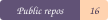
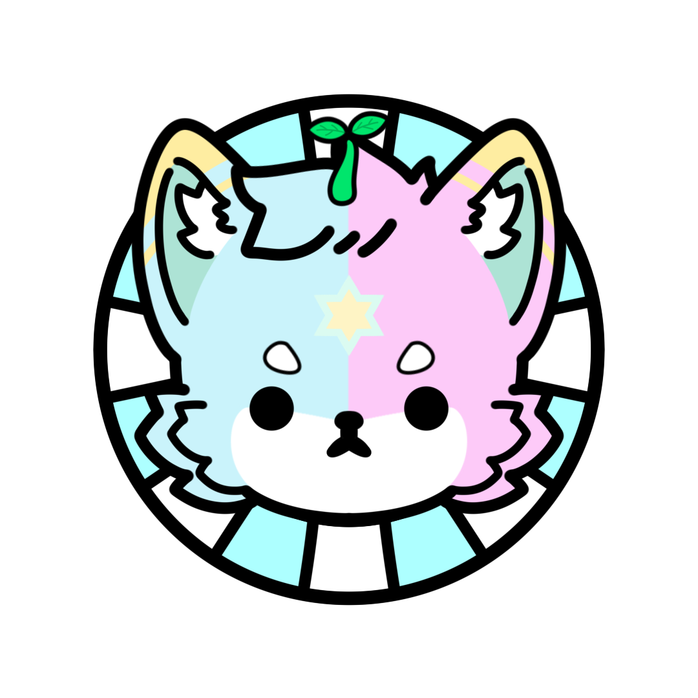

<!-- BEGIN typing-animation -->

  <picture>
    <source media="(prefers-color-scheme: dark)" srcset="https://readme-typing-svg.demolab.com?font=Comic+Neue&amp;size=22&amp;pause=1200&amp;color=FFAEC5&amp;background=00000000&amp;center=true&amp;vCenter=true&amp;width=760&amp;height=60&amp;lines=Hi%2C+I%27m+Shadows_Lunarfox+%E6%9C%88%E7%8B%90;Building+websites%2C+games+%26+little+experiments;Coding+from+Kuala+Lumpur%2C+Malaysia" />
    
  </picture>

<!-- END typing-animation -->

  
  
  

<!-- BEGIN lunarfox-corner -->
<h2 align="center">🌙 <samp>Lunarfox · 月狐小窝</samp> 🐾</h2>

<table align="center" width="100%">
  <tr>
    <td align="center" valign="middle" width="136">
      
       <samp>(｡･ω･｡)ﾉ</samp>
    </td>
    <td valign="middle">
      
🦊 <samp>Hey there!</samp> 
      <strong><samp>I'm Shadows_Lunarfox</samp></strong> 
      📍 Kuala Lumpur, Malaysia

      
<strong>Code tinkerer · Retro collector</strong> 
      <em>Small ideas, fluffy tails &amp; a little chaos.</em>

    </td>
  </tr>
  <tr>
    <td colspan="2" valign="top">
      

        
        
        
      

      <h3>🧩 <samp>A Little Code, A Little Chaos</samp></h3>
      
<strong>🧂 Pocket Skill:</strong> Java? Just a tiny pinch. <em>Literally a pinch—no secret Java wizard hiding here!</em> 😂

      
<strong>🐛 Dev Joke:</strong> 
      <em>"If my code compiles on the first try, I'll start suspecting my life and hunt for hidden bugs."</em>

      
✨ Expert at turning bugs into features. 
      🖨️ Completely helpless when it comes to fixing printers. <em>My true final boss.</em>

    </td>
  </tr>
  <tr>
    <td colspan="2" valign="top">
      <h3>⚙️ <samp>Retro Collector</samp> ( •̀ ω •́ )✧</h3>
      
Besides coding, I have a soft spot for <strong>vintage components and classic tech gear</strong>. To me, retro devices are little works of art. 💾

      
Bringing them back to life gives me more adrenaline than running new code. Think of me as a <strong>"digital archaeologist"</strong>, digging for treasure in electronic ruins. 🔎

      
<strong>🦊 Random Thought:</strong> 
      Wait… why did I buy a domain ending in <strong>.wtf</strong> again?! 
      Must have been bored and fidgety. Someone save this fox with a <strong>3-second memory span</strong>! 🍼

    </td>
  </tr>
</table>

<table align="center" width="100%">
  <tr>
    <td align="center" valign="top" width="50%">
      
<strong>🍡 <samp>Coding Languages</samp></strong>

      
      
      
      
      
      
      
    </td>
    <td align="center" valign="top" width="50%">
      
<strong>🎨 <samp>Creative Toolbox</samp></strong>

      
      
      
      
      
      
    </td>
  </tr>
</table>

  <strong>💌 <samp>Come Say Hello</samp></strong> 
  
  
  
  
  

<!-- END lunarfox-corner -->

<!-- BEGIN learning-badges -->
<h2 align="center">🏅 <samp>Learning &amp; Badges</samp></h2>

  <a href="https://g.dev/lunarfox"><strong>Google Developer Program</strong></a> · 4 badges
   
  
  
  
  

  <a href="https://learn.microsoft.com/en-us/users/shadowslunarfox-4093/achievements"><strong>Microsoft Learn</strong></a> · 4 module badges · 2 trophies
   
  
  
  
  
  
  

Badge details · 10 achievements

<table>
  <tr><th>Platform</th><th>Achievement</th><th>Details</th></tr>
  <tr><td>Google</td><td><a href="https://developers.google.com/profile/badges/profile/created-profile?u=lunarfox">Joined the Google Developer Program</a></td><td>Program badge</td></tr>
  <tr><td>Google</td><td><a href="https://developers.google.com/profile/badges/community/gdg/discovery?u=lunarfox">Google Developer Group discovery</a></td><td>Program badge</td></tr>
  <tr><td>Google</td><td><a href="https://developers.google.com/profile/badges/community/sdlcagents/gca-agents?u=lunarfox">Code Wiki</a></td><td>Program badge</td></tr>
  <tr><td>Google</td><td><a href="https://developers.google.com/profile/badges/nvidia-developer?u=lunarfox">Google Cloud &amp; NVIDIA community member</a></td><td>Program badge</td></tr>
  <tr><td>Microsoft</td><td><a href="https://learn.microsoft.com/en-us/users/shadowslunarfox-4093/achievements">Understand AI agents and prompting</a></td><td>Module badge · 2026-10-15</td></tr>
  <tr><td>Microsoft</td><td><a href="https://learn.microsoft.com/en-us/users/shadowslunarfox-4093/achievements">Prepare to use generative AI at work</a></td><td>Module badge · 2026-10-15</td></tr>
  <tr><td>Microsoft</td><td><a href="https://learn.microsoft.com/en-us/users/shadowslunarfox-4093/achievements">Work smarter with AI</a></td><td>Module badge · 2026-10-15</td></tr>
  <tr><td>Microsoft</td><td><a href="https://learn.microsoft.com/en-us/users/shadowslunarfox-4093/achievements">Work smarter with AI</a></td><td>Learning path trophy · 2026-10-15</td></tr>
  <tr><td>Microsoft</td><td><a href="https://learn.microsoft.com/en-us/users/shadowslunarfox-4093/achievements">Enhance your productivity with prebuilt Microsoft 365 Copilot agents</a></td><td>Learning path trophy · 2026-10-15</td></tr>
  <tr><td>Microsoft</td><td><a href="https://learn.microsoft.com/en-us/users/shadowslunarfox-4093/achievements">Explore prebuilt Microsoft Copilot agents</a></td><td>Module badge · 2026-10-15</td></tr>
</table>

<!-- END learning-badges -->

<!-- BEGIN featured-repositories -->
<!-- Generated from .github/featured-repositories.json; edit that file to change the cards. -->
<h2>✨ <samp>Featured Repositories (ง •̀_•́)ง</samp></h2>

  <a href="https://github.com/ShadowsLunarfox/Roblox-Customizer">
    <picture>
      <source media="(prefers-color-scheme: dark)" srcset="assets/profile/repositories/repo-1-dark.svg" />
      
    </picture>
  </a>
  <a href="https://github.com/ShadowsLunarfox/YouTube-Customizer">
    <picture>
      <source media="(prefers-color-scheme: dark)" srcset="assets/profile/repositories/repo-2-dark.svg" />
      
    </picture>
  </a>

  <a href="https://github.com/ShadowsLunarfox/Selection-Text-Reader">
    <picture>
      <source media="(prefers-color-scheme: dark)" srcset="assets/profile/repositories/repo-3-dark.svg" />
      
    </picture>
  </a>
  <a href="https://github.com/ShadowsLunarfox/Lunar-Start-Page">
    <picture>
      <source media="(prefers-color-scheme: dark)" srcset="assets/profile/repositories/repo-4-dark.svg" />
      
    </picture>
  </a>

  <a href="https://github.com/ShadowsLunarfox/Server-Check-Status">
    <picture>
      <source media="(prefers-color-scheme: dark)" srcset="assets/profile/repositories/repo-5-dark.svg" />
      
    </picture>
  </a>
  <a href="https://github.com/ShadowsLunarfox/Custom-Hierarchy-for-Unity">
    <picture>
      <source media="(prefers-color-scheme: dark)" srcset="assets/profile/repositories/repo-6-dark.svg" />
      
    </picture>
  </a>

  <a href="https://github.com/ShadowsLunarfox/Custom-Folder-For-Unity">
    <picture>
      <source media="(prefers-color-scheme: dark)" srcset="assets/profile/repositories/repo-7-dark.svg" />
      
    </picture>
  </a>

<!-- END featured-repositories -->

<!-- BEGIN github-stats -->
<h2 align="center">📊 <samp>GitHub Stats (＾▽＾)</samp></h2>

  <picture>
    <source media="(prefers-color-scheme: dark)" srcset="assets/profile/stats-dashboard-dark.svg" />
    
  </picture>

<!-- END github-stats -->

<!-- BEGIN activity-graph -->
<h2 align="center">🌱 <samp>Activity Graph</samp></h2>

  <picture>
    <source media="(prefers-color-scheme: dark)" srcset="assets/profile/activity.svg" />
    
  </picture>

<!-- END activity-graph -->

<h2 align="center">🐍 <samp>Contribution Snake</samp></h2>

  <picture>
    <source media="(prefers-color-scheme: dark)" srcset="assets/profile/github-snake-dark.svg" />
    <source media="(prefers-color-scheme: light)" srcset="assets/profile/github-snake.svg" />
    
  </picture>

<!-- BEGIN 3d-contributions -->
<h2 align="center">🌌 <samp>3D Contributions (☆▽☆)</samp></h2>

  <picture>
    <source media="(prefers-color-scheme: dark)" srcset="assets/profile/3d-contributions-dark.svg" />
    <source media="(prefers-color-scheme: light)" srcset="assets/profile/3d-contributions-light.svg" />
    
  </picture>

<!-- END 3d-contributions -->

